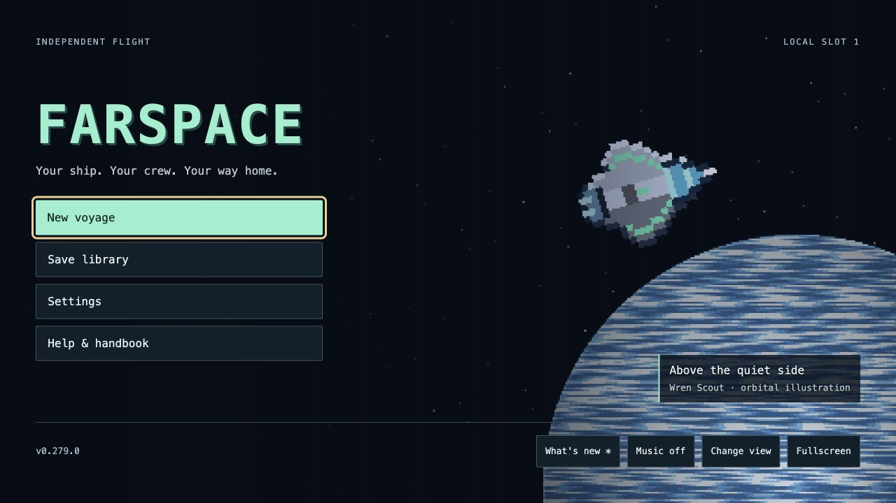
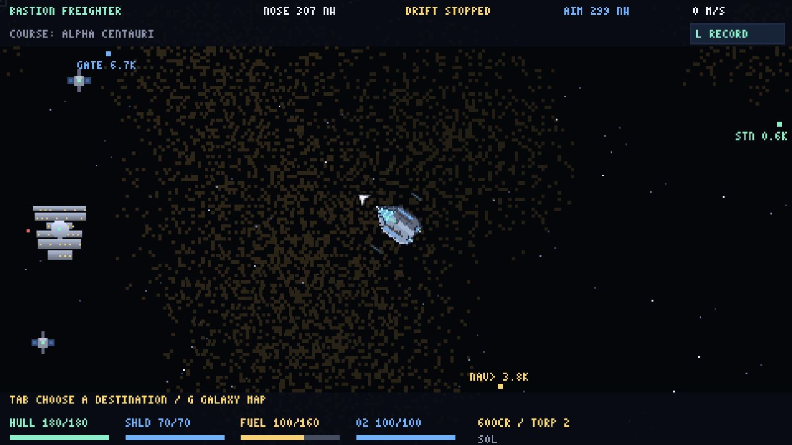
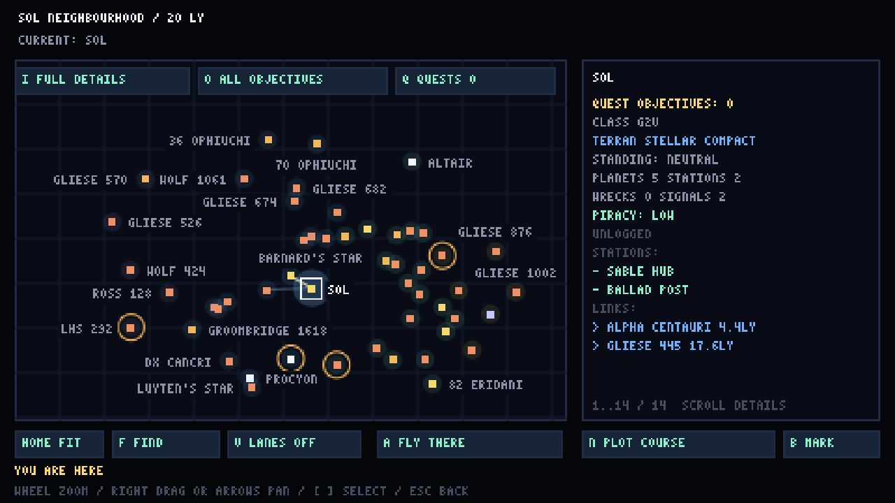
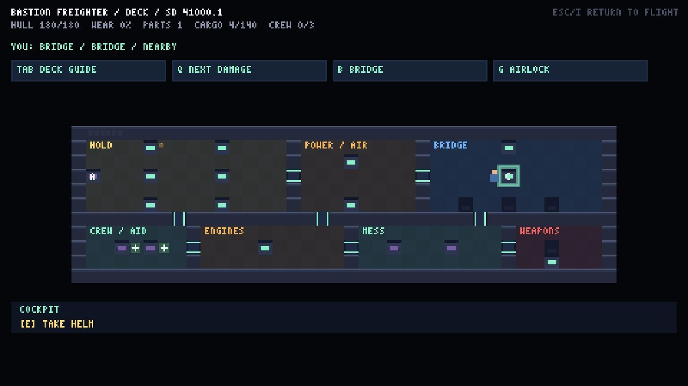
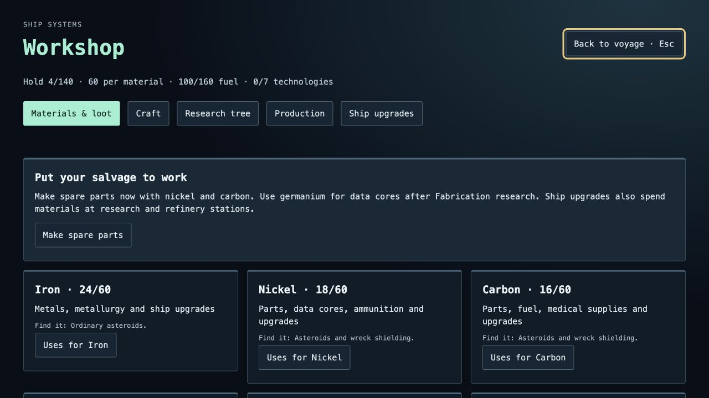
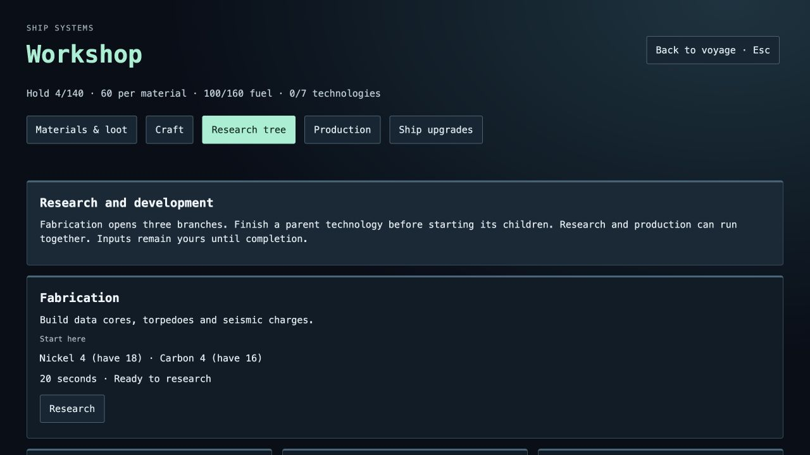

# FarSpace

A space game you can play in your browser. Fly your own ship, hire a crew,
trade between stations and explore nearby stars. Salvage wrecks, repair damaged
ships and turn what you find into supplies and upgrades.

**[Play FarSpace](https://farspace.fsociety.work/)** ·
[How to play](docs/PLAYING.md) ·
[What's next](docs/NEXT-MILESTONES.md)



## What you can do

- **Fly and explore.** Choose from several ships, from a small scout to a carrier.
  Your ship keeps moving after you stop thrusting, so turning and braking matter.
  Explore real stars near Sol or start with a newly generated galaxy.
- **Choose a destination.** Use the system and galaxy maps to find stations,
  planets, wrecks and quest locations. Plot a route or choose Fly there to start
  autopilot. You can take control again whenever you need to.
- **Trade and take jobs.** Buy and sell goods, carry passengers, deliver supplies
  and accept contracts. Prices and opportunities change as stations face
  shortages, strikes and conflict.
- **Mine and build.** Extract ore, break open core asteroids and collect materials.
  The Workshop shows what each material is used for. Make spare parts, fuel,
  ammunition and medical supplies, then research more recipes and equipment.
- **Recover ships.** Strip useful parts from wrecks or board abandoned ships.
  Repair recoverable ships and tow them to a station to keep or sell. Combat
  can leave a ship disabled and available for recovery.
- **Walk your ship.** Visit the bridge, engines, hold and crew rooms. Follow the
  deck guide to damaged equipment, repair it, seal breaches and put out fires.
- **Look after people.** Hire crew with their own skills and stories. Carry
  passengers, answer distress calls, transfer fuel, repair stranded ships and
  bring survivors to a safe port.
- **Visit places on foot.** Walk station decks, cities and outposts. Land a rover
  on a planet, take crew with you and investigate what you find.
- **Follow stories and make choices.** Work through campaigns, crew requests and
  encounters. Other captains remember your help. Faction standing affects how
  you are treated, and traffic control offers ways to settle trouble.
- **Keep your voyage.** Use local saves and the save library, with optional cloud
  saves. Your return briefing shows where you are, what you carry and what to
  do next. Save postcards and read your captain's log.

The main game is single player. Optional online features include seeing other
pilots, a system chat channel, shared discoveries and leaderboards.

## Screenshots

Captured from v0.279.0 using a local demonstration voyage.

| Flying near a station | Exploring the galaxy |
| --- | --- |
|  |  |
| Keep your heading, course and ship condition in view. | Inspect a system, find a route and choose where to fly. |

| Walking your ship | Using materials |
| --- | --- |
|  |  |
| Find the bridge, engines, hold and crew rooms. | Check your supplies and find recipes that use them. |

<details>
<summary>See the research screen</summary>



Each research choice explains what it unlocks and which supplies it needs.

</details>

## Make room for the view

Open **Esc → Settings** during flight. The display controls are at the top.

| Setting | Choices |
| --- | --- |
| Flight HUD | **Full** shows the expanded display. **Compact** uses smaller panels. **Minimal** keeps direction, course, ship condition and your current action. |
| HUD Background | Choose **30% to 100%** opacity. Text stays solid while more of space shows through the panels. |
| Screen Size | **Fit Window** uses the available space. **Whole Pixels** uses the previous size steps. |

Compact and Fit Window are the defaults. Critical warnings still appear in the
smaller displays. Press **L** for the complete flight record.

## Start playing

Choose **New voyage** on the title screen. The opening delivery job introduces
flying, docking and saving. Use **F4** to check your next objective and **F2**
to open the Workshop when you want to use your materials.

| Action | Default controls |
| --- | --- |
| Thrust and slow down | **W / S** |
| Turn | **A / D** |
| Aim and fire | **Mouse** to aim, **left click** or **Space** to fire |
| Mine | **Right click** or **M** |
| Brake | **X** |
| Dock, jump or interact | **E** |
| System map / galaxy map | **Tab / G** |
| Start or cancel autopilot | **N** |
| Walk inside your ship | **I** |
| Walk / use something | **WASD / E** |
| Repair equipment | Hold **E** beside it |
| Workshop / voyage briefing | **F2 / F4** |
| Save / load | **F5 / F9** |
| Pause and settings | **Esc** |

Keyboard, mouse, controller and touch controls are supported. Flight keys can
be changed in Settings. See the [player guide](docs/PLAYING.md) for controls
used in stations, on planets and aboard other ships.

## Current work

The screenshots show **v0.279.0**, which adds adjustable flight displays and
window fitting. Crafting, research, production queues, ship recovery and quest
markers are already playable.

Planned work includes port material storage, automatic mining orders, cargo
delivery runs and more research choices. Small screen readability and longer
play sessions still need testing. The [milestone plan](docs/NEXT-MILESTONES.md)
tracks progress and remaining work.

## Run it on your computer

Install [Node.js](https://nodejs.org/), then run these commands in the project
folder:

```bash
npm install
npm run dev
```

Open the local address printed in the terminal.

```bash
npm test        # Run the checks
npm run build   # Create the files used by the website
npm run preview # Open the built game locally
```

To host your own copy, use the [hosting guide](docs/DEPLOY.md). A ready to run
container is available at `ghcr.io/aes256afro/farspace`, and the BoxPilot
installation files are in [deploy/boxpilot](deploy/boxpilot/).

